# ML Convertor

Office hujjatlarini boshqa formatga o'giradigan buyruq satri vositasi — hech qayerga yuklamasdan.

```bash
ml_convertor xls2pdf hisobot.xls hisobot.pdf
```

---

**Sahifa:** [abduazizbobomalikovnode.github.io/ml_convertor_free/](https://abduazizbobomalikovnode.github.io/ml_convertor_free/)

## Muammo

Faylni PDF qilish kerak bo'lganda odam odatda onlayn konvertorga yuklaydi. Qulay, lekin hujjat begona serverga chiqib ketadi. Shartnoma, moliyaviy hisobot yoki shaxsiy ma'lumot bo'lsa — bu yo'l umuman yaramaydi.

Qo'lda ochib "Save as" qilish esa bitta fayl uchun ish, yuzta fayl uchun kun.

## Nima qiladi

- **Excel** → PDF, HTML, XLS, XLSX, XLSB, CSV, ODS va boshqalar
- **Word** → PDF, DOC, DOCX, RTF, TXT, XML, ODT va boshqalar
- **PowerPoint** → PPTX, PPT, PPSX, PPS, ODP, XML, RTF, HTML
- **Hech qayerga yuklanmaydi** — hammasi sizning kompyuteringizda
- **Log yozadi** — nima o'girildi, nima xato berdi

## Qanday ishlaydi

<p align="center">
  
</p>

Konvertatsiyani tizimda o'rnatilgan ofis dasturi bajaradi:

| Tizim | Nimadan foydalanadi |
|---|---|
| Linux | LibreOffice (buyruq satri orqali) |
| Windows | Microsoft Office (Excel, Word, PowerPoint) |

Ya'ni natija sifati o'sha dasturning o'zi bergan sifat bilan bir xil — onlayn xizmatlardagi kabi formatlash buzilmaydi.

Har amal `conversion_log.log` fayliga yoziladi: qaysi fayl, qaysi formatga, muvaffaqiyatli bo'ldimi.

## O'rnatish

```bash
git clone https://github.com/AbduazizBobomalikovNode/ml_convertor_free.git
cd ml_convertor_free
pip install .
```

Talab: Python 3, va tizimga qarab LibreOffice (Linux) yoki Microsoft Office (Windows).

## Ishlatish

```bash
ml_convertor <amal> <kiruvchi fayl> <chiquvchi fayl>
```

Amal nomi `<qaysidan>2<qaysiga>` ko'rinishida yoziladi. Kiruvchi formatlar: `xls`, `xlsx`, `doc`, `docx`, `ppt`, `pptx`.

Misollar:

```bash
ml_convertor xls2pdf  hisobot.xls    hisobot.pdf
ml_convertor docx2pdf shartnoma.docx shartnoma.pdf
ml_convertor ppt2pptx taqdimot.ppt   taqdimot.pptx
```

CLI bo'lgani uchun uni skriptga qo'shish yoki papkadagi barcha fayllarni sikl bilan o'girish mumkin:

```bash
for f in *.docx; do ml_convertor docx2pdf "$f" "${f%.docx}.pdf"; done
```

## Tuzilma

```
src/
  main.py       buyruq satri (ml_convertor)
  convertor.py  konvertatsiya mantiqi va log
  checker.py    ofis dasturi o'rnatilganini tekshiradi
setup.py     paket sozlamalari
docs/        landing sahifa
```

## Texnologiyalar

Python · LibreOffice · Microsoft Office COM
